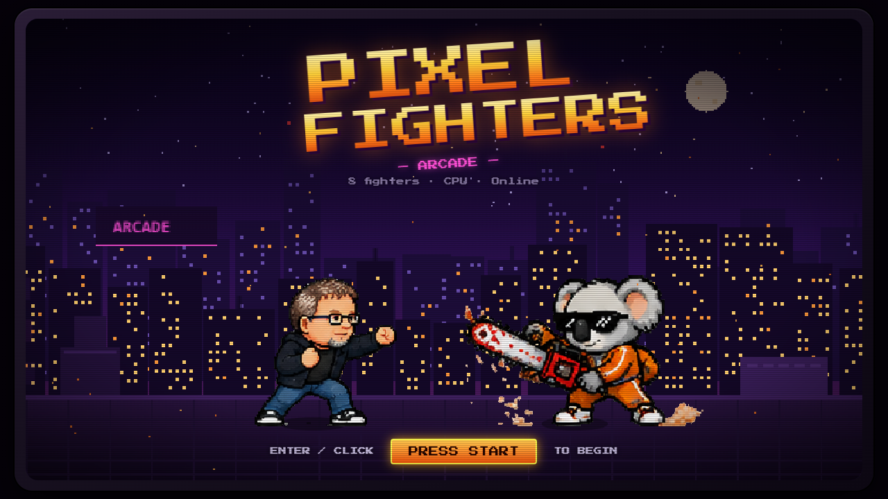
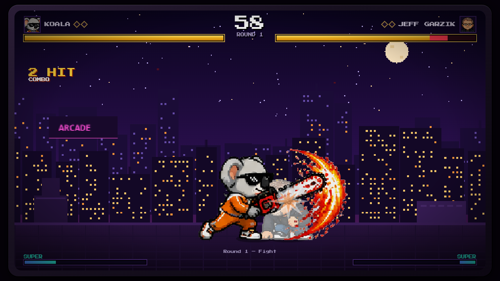
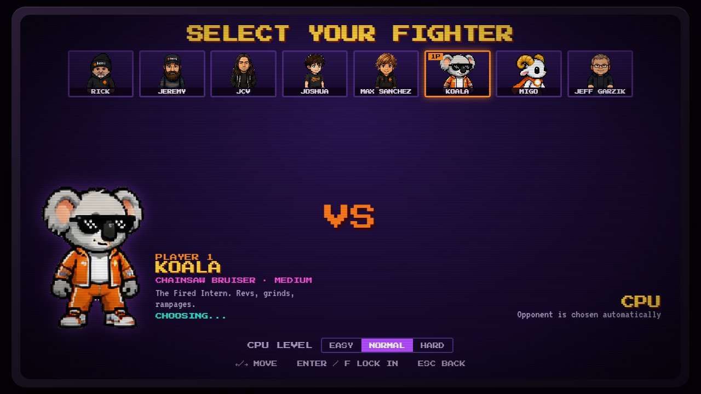
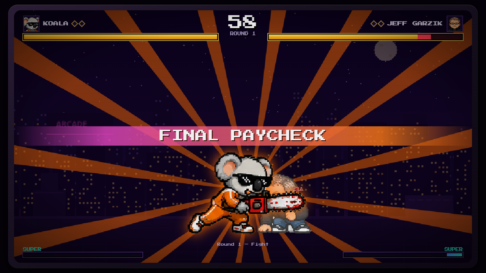

# Pixel Fighters: Arcade

A browser pixel-art fighting game with eight fighters built from the supplied character sprite sheets. It has a single-player mode against a three-level AI and **online multiplayer** through an authoritative Node.js WebSocket server. The arcade presentation (CRT frame, purple neon, night-city stage, centre timer, combo counter, named supers) is inspired by the *Agent Fighter* reference video.





| | |
|---|---|
|  |  |

## Quick start

Requires **Node.js 20+** (developed on Node 24).

```bash
npm install
npm run dev
```

Open **http://localhost:5173**. `npm run dev` starts the game server on :8787 and the Vite client on :5173 together; the client reaches the server through Vite's `/ws` proxy.

| Command | What it does |
|---|---|
| `npm run dev` | server + client with hot reload |
| `npm run dev:client` | Vite client only (http://localhost:5173) |
| `npm run dev:server` | game server only (http://localhost:8787, `/ws`, `/health`) |
| `npm run build` | type-check and build client (`client/dist`) and server (`server/dist/index.js`) |
| `npm start` | run the built server; with `NODE_ENV=production` (or `SERVE_CLIENT=true`) it also serves the built client |
| `npm run test` | unit + integration tests (Vitest, real WebSocket clients) |
| `npm run test:e2e` | browser tests (Playwright, uses your installed Chrome; builds first) |
| `npm run typecheck` | TypeScript checks for client, server and scripts |
| `npm run assets:inspect` | report size/alpha/checkerboard of the source sheets |
| `npm run assets:process` | regenerate atlases, portraits, metadata and previews from the source sheets |
| `npm run docs:generate` | regenerate `docs/MOVES.md` and `docs/ANIMATION_MAPPING.md` from code/data |
| `npm run simulate` | headless AI-vs-AI balance simulation |

## Title screen

The title and menus play a live fight between two randomly chosen roster fighters on a parallax neon rooftop, with drifting haze and embers. It runs on the real combat engine but uses a private demo match driven by a scripted "fight director" (`client/src/game/demo/`). The director stages face-offs, footsies, jab and kick strings, blocked strings, dash punches, sweeps, projectiles, anti-airs and supers, with pauses between exchanges, and swaps fighters every few exchanges. It never touches real matches, reads no keyboard, plays no sound, pauses while the tab is hidden, and stops when a match starts.

## Modes

* **1 Player vs CPU**: pick your fighter and CPU level. The opponent is then chosen automatically at random from the other seven fighters, shown on a VS screen with a 3-2-1 countdown, and played by the AI. Rematch keeps the same opponent; **NEW OPPONENT** on the results screen draws a new one.
* **Online Versus**: create a room, share the 5-character code, the friend joins, both choose a fighter and press READY. The match runs on the server. Afterwards you can vote for a rematch, change fighter or leave.

Rules: 60-second rounds, best of three (both configurable in Options). A timeout goes to the higher remaining health percentage.

## Controls

| Action | Keys |
|---|---|
| Move / jump / crouch | A D / W / S |
| Light / Heavy Punch | F / G |
| Light / Heavy Kick | V / B |
| Special / Super | H / J |

* **Block:** hold away from the opponent. Crouch-block lows; stand-block overheads and jump-ins.
* **Dash:** double-tap forward or back. Attacks pressed during a forward dash come out as dash attacks.
* **Specials:** Special, or Down + Special for the alternate special. Down + Heavy Kick is a sweep/launcher.
* **Super:** when the meter shows SUPER READY.
* **Combos:** land a light attack, then press a heavy or special during its cancel window. Damage scales down over long combos.
* **Esc** pauses single-player matches. Online play uses the same keys on both computers.
* Every key can be rebound in **Options** (stored in the browser).

Full move lists and frame data: [docs/MOVES.md](docs/MOVES.md) (also in-game under HOW TO PLAY).

## The fighters

| Fighter | Style | Signature moves |
|---|---|---|
| Rick | Rushdown | 3-frame jab, Burst Punch (dashing two-hit), invulnerable Rising Burst, **Hemi Inferno** |
| Jeremy | Pressure tank | heavy punches, Haymaker Wave projectile, armored Guard Crush, **Grand Slam** |
| JCV | Speedster | fastest walk/dash, Flash Step dash-through, launching Air Riff, **Riff Storm** |
| Joshua | All-rounder | Hemi Spark fireball, Rising Kick anti-air, **Cyclone Kick** |
| Max Sanchez | Launcher | Launch Kick / Sky Kick juggles, fast Blaze Punch, **Blaze Wheel** |
| Koala (The Fired Intern) | Chainsaw bruiser | 5-hit Rev Grind, Spark Spray, Leaping Saw overhead, **Final Paycheck** |
| Migo | Counter fencer | Crescent Wave projectile, Counter Stance parry, **Ram Tempest** |
| Jeff Garzik | Precision technician | longest cancel windows, fast Precision Shot, Pinpoint Dive overhead, **Hash Cyclone** |

These are fictional gameplay designs inspired by the sprite artwork, not statements about the real people the characters are named after.

## Testing online multiplayer locally (two browser sessions)

1. `npm run dev`
2. Window 1: http://localhost:5173 → PLAY → ONLINE VERSUS → **CREATE ROOM**. Note the code.
3. Window 2: open a **private/incognito window** (or a different browser) at http://localhost:5173 → ONLINE VERSUS → **JOIN ROOM** → enter the code.
4. Pick fighters in both windows and press **READY**. Each window controls its own fighter with the Player 1 keys; click a window to give it keyboard focus.

Shortcut: http://localhost:5173/?screen=online opens the online lobby directly.

**Two computers on the same network:** run `npm run dev:server` plus `npx vite --config client/vite.config.ts --host` on one machine, then open `http://<that-machine's-LAN-IP>:5173` on both. Allow Node through the OS firewall if prompted.

**Over the internet:** deploy the server (see below).

## Deployment

See **[docs/DEPLOYMENT.md](docs/DEPLOYMENT.md)**. In short:

* **Recommended:** one Node web service that serves the built client and the WebSocket server on one HTTPS origin. Render (`render.yaml` blueprint included) or any Docker host (`Dockerfile` included). Build with `npm ci --include=dev && npm run build`, start with `npm start`, health check `/health`. In production the server accepts WebSockets only from its own host by default; behind a proxy set `TRUST_PROXY` (`cloudflare` on Render, or `xff` with `TRUSTED_PROXIES`; see the deployment guide).
* **Split hosting:** a static host for `client/dist` (built with `VITE_WS_URL=wss://your-server/ws`) plus a WebSocket-capable Node host for the server.
* Static hosts cannot run the game server. **Vercel, Netlify, GitHub Pages and similar can host only the frontend**: online play there shows *SERVER UNAVAILABLE* unless the frontend is built with `VITE_WS_URL` pointing at a game server running on a WebSocket-capable host (for example Render). Production must use `wss://`.

**Status:** not yet deployed publicly; this needs your hosting account. Everything was verified locally (see Testing).

## Architecture

```
shared/src/          deterministic game core, used by BOTH client and server
  engine/            60 Hz simulation: movement, physics, hitboxes, blocking, combos, meter, rounds
  characters/        eight-character roster with move data
  ai/                CPU opponent (perception delay, blocking, anti-air, punishes, combos)
  protocol.ts        versioned network messages + strict validation
client/src/          React menus + Canvas 2D arena
  game/              renderer, procedural stages/effects, sprite animation, input, audio, HUD model
  multiplayer/       WebSocket client (reconnect + resume) and snapshot-interpolating online runner
  screens/ components/
server/src/          Node + ws authoritative server
  networking/        HTTP (/health, static client), WebSocket upgrade, origin check, limits, 60 Hz loop
  rooms/             rooms, players, readiness, countdown, pause/resume, forfeit, rematch
  security/          rate limiting, origin allow-list
scripts/             sprite pipeline (inspect, background removal, slicing, atlas, metadata, previews), docs generator, balance sim
tests/unit|integration|e2e
docs/                audit, animation mapping, moves, protocol, deployment, testing, screenshots
```

* **Fixed timestep with interpolation:** the simulation always advances in 1/60 s steps. Rendering runs independently with `requestAnimationFrame` and draws fighter positions blended between the last two steps, so movement is even at any refresh rate; sprites still snap to whole pixels and use nearest-neighbour scaling. Effects, screen shake and stage animation advance per simulation frame, not per rendered frame.
* **Online is server-authoritative:** clients send sequenced input bitmasks. The server steps the same engine and broadcasts 30 Hz snapshots plus events, and clients interpolate. The protocol is documented in [docs/PROTOCOL.md](docs/PROTOCOL.md).

## Assets

The eight original sheets in `client/public/assets/characters/source/` are never modified. They had a checkerboard painted into fully opaque pixels, which the pipeline removes with a controlled, validated process that preserves light fur, white wool, outlines and fire effects. Frames are sliced without assuming a grid. Details, statistics and remaining artifacts: [docs/ASSET_AUDIT.md](docs/ASSET_AUDIT.md). Frame-by-frame mapping, including which animations are derived because the sheets have no jump, hurt or block art: [docs/ANIMATION_MAPPING.md](docs/ANIMATION_MAPPING.md).

Stages, effects, UI and audio are original and generated in code.

## Testing

153 unit + integration tests and 36 Playwright browser tests, all passing. The browser tests run against both the production build and the dev server. This includes a two-browser-context online match and the 13 required online scenarios against a real server. Details and raw outputs: [docs/TESTING.md](docs/TESTING.md).

## Debugging

**Sprite transparency:** with `npm run dev` running, open http://localhost:5173/asset-preview.html to inspect any character frame. It shows the original sheet, the processed atlas, the extracted frame, and that frame over contrasting backgrounds. After changing `scripts/lib/bgremove.ts`, run `npm run assets:process` and `npm run test`.


In development (`npm run dev`), press **F2** during an offline match, or open the game with `?debug=1`, to show a debug panel. It lists the mode, both fighters, the controller for each slot, player state, animation frame, last inputs, attack phase, last hit and game-loop status. It is compiled out of production builds.

## Known limitations

* **Netcode:** server-authoritative with interpolation and no client-side prediction or rollback. Your own inputs are delayed by about half the round trip plus ~67 ms of interpolation. That is fine on good connections but noticeably laggy on high-ping links.
* **Derived animations:** the sheets have no jump, hit-reaction, block or back-dash art, so these reuse existing frames plus engine effects (documented).
* **Mirrored text:** fighters facing left are mirrored, so logos on clothing read backwards.
* **Balance:** tuned with AI-vs-AI simulation (30–65% win rates at Normal); it has not been human-playtested.
* **Online pause:** online matches cannot be paused. Leaving forfeits.
* **Browsers:** tested in Chrome only. No gamepad support (keyboard only).
* **Hosting:** Render's free plan sleeps when idle, and the Dockerfile has not been built yet.

## License

The **source code** is released under the [MIT License](LICENSE).

The **character artwork** (the sprite sheets in `client/public/assets/characters/source/` and everything derived from them: processed atlases, portraits, previews and screenshots) is **not** covered by the MIT License. It is used with the permission of its owners, and all rights remain with them. Do not reuse it outside this project without permission. Fonts are loaded from Google Fonts (SIL Open Font License). Stages, effects and audio are generated in code and are covered by the MIT License.
